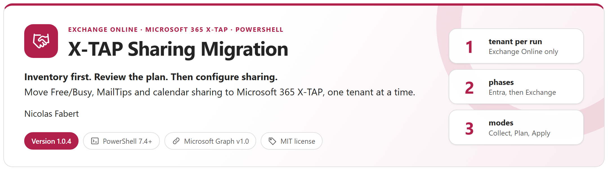
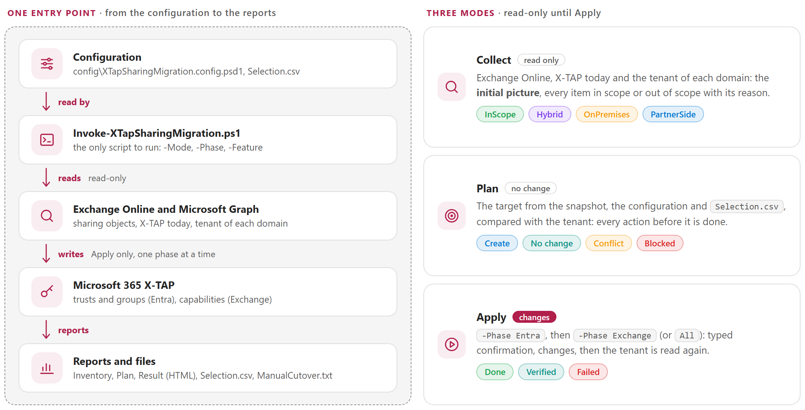
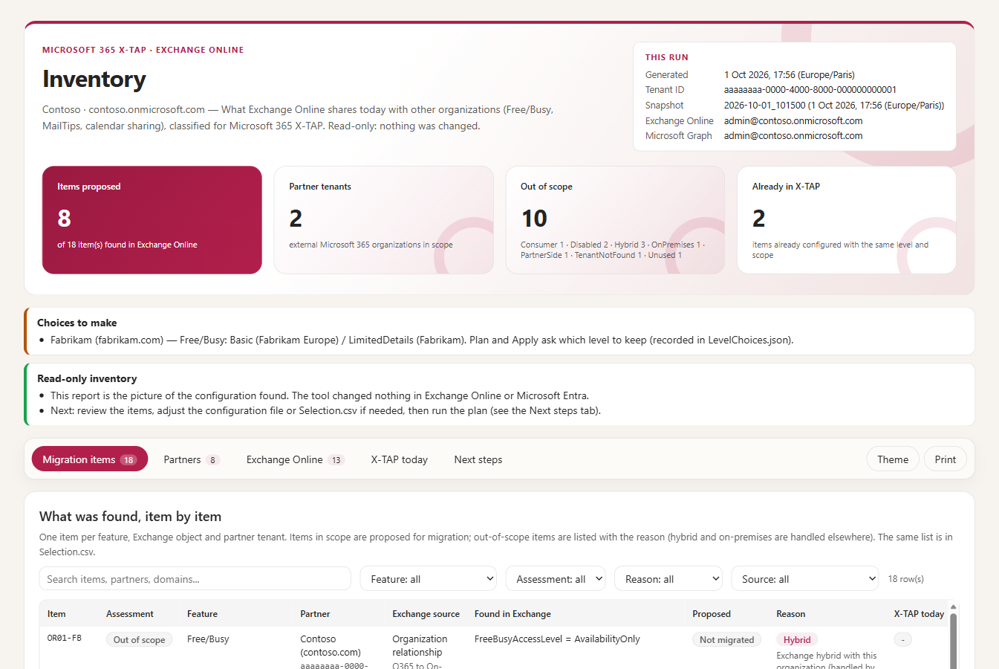

<p align="center">
  <picture>
    <source media="(prefers-color-scheme: dark)" srcset="package/docs/images/readme-banner-dark.png">
    
  </picture>
</p>

<p align="center">
  <a href="#quick-start"><b>Start here</b></a> &nbsp;&middot;&nbsp;
  <a href="#how-it-works"><b>How it works</b></a> &nbsp;&middot;&nbsp;
  <a href="#reports"><b>Reports</b></a> &nbsp;&middot;&nbsp;
  <a href="package/docs/XTapSharingMigration-UserGuide.md"><b>User guide</b></a> &nbsp;&middot;&nbsp;
  <a href="package/docs/XTapSharingMigration-Guide.md"><b>Technical guide</b></a> &nbsp;&middot;&nbsp;
  <a href="CHANGELOG.md"><b>What's new</b></a>
</p>

<p align="center">
  <a href="https://github.com/Nico77600/XTapSharingMigration/releases/latest"></a>
</p>

**Author:** Nicolas Fabert

> [!IMPORTANT]
> **To use the tool, download the release package.** Open [the latest release](https://github.com/Nico77600/XTapSharingMigration/releases/latest), expand **Assets**, and download `XTapSharingMigration-<version>.zip`.
>
> Do not choose **Source code (zip)**, **Source code (tar.gz)** or the green **Code** button: those are for development. The release ZIP includes the ready-to-run files and offline HTML guides.
>
> This page describes the current source. [What's new](CHANGELOG.md) lists the changes of each version.

## Why

You currently share calendars, availability or MailTips with another Microsoft 365 organization. Microsoft is moving these settings to **X-TAP**, the Microsoft 365 cross-tenant access policy ([Microsoft migration guidance](https://learn.microsoft.com/exchange/sharing/migrate-to-m365-xtap)).

This tool helps you answer three questions: **What do we share today? What will change? What was actually configured?** It works on **one tenant at a time**. It does not configure the partner's tenant for you.

Exchange hybrid and partners hosted on Exchange Server are excluded. Anonymous calendar publishing is handled separately from sharing with named people; HTML/ICS publishing does not depend on EWS.

## How it works

<picture>
  <source media="(prefers-color-scheme: dark)" srcset="package/docs/images/readme-how-it-works-dark.png">
  
</picture>

| Step | What you do | Changes the tenant? |
|---|---|---|
| **Collect** | Save the current Exchange Online and X-TAP settings; open `Inventory.html` | **No** |
| **Plan** | Confirm partner tenant IDs, review users and detail levels; open `Plan.html` | **No** |
| **Apply -Phase Entra** | Create the required security groups and partner collaboration trusts | **Yes**, after confirmation |
| **Apply -Phase Exchange** | Write the sharing capabilities, then read the settings back | **Yes**, after confirmation |
| **Test with the partner** | Check what users can actually see before retiring any legacy setting | Manual, separately agreed |

### What stays protected

- **Existing settings are kept by default.** A difference is reported as a conflict, not silently overwritten.
- **Calendar Sharing keeps each policy's users.** A mailbox group is proposed for every Sharing Policy, even a single policy. Missing assignments or extra group members require review. Tenant-wide `All` remains an explicit choice.
- **No Exchange Online cutover is executed by the tool.** `ManualCutover.txt` contains proposals to review, not a script to run blindly. Wildcard retirement commands are commented out to protect on-premises/hybrid dependencies.
- **A green configuration result is not a successful sharing test.** Calendar Sharing X-TAP takes precedence when applicable: test with Sharing Policies enabled. Free/Busy and MailTips have different legacy precedence.

The [technical guide](package/docs/XTapSharingMigration-Guide.md#3-what-is-migrated--and-what-is-not) explains feature mappings, `All/group`, scope groups and default/partner policies.

## Reports

<table>
  <tr>
    <td width="50%" valign="top"><a href="package/docs/images/report-inventory.png"></a><br><sub><b>Inventory.html</b> &middot; what exists today</sub></td>
    <td width="50%" valign="top"><a href="package/docs/images/report-plan.png"></a><br><sub><b>Plan.html / Result.html</b> &middot; proposed or completed configuration actions</sub></td>
  </tr>
</table>

These are illustrative screenshots. Current reports show the exact scope types and updated cutover warnings. Reports open locally in a browser, with light/dark themes, search and filters. Keep the Collect folder: Plan and Apply use its saved inventory.

Reports and logs can contain tenant IDs, mailbox addresses and configuration. Store them securely; do not attach them unredacted to a public issue.

## Requirements

| You need | Before starting |
|---|---|
| **PowerShell 7.4+** | Open **PowerShell 7**, not Windows PowerShell 5.1 |
| **Modules** | `Microsoft.Graph.Authentication` 2.25+; `ExchangeOnlineManagement` 3.9+ for Collect (use 3.10.1+ when installing) |
| **Read access** | An Exchange role able to read sharing settings, plus the Graph read permissions listed in the user guide |
| **Entra phase** | Security Administrator and Groups Administrator when groups are created, or Global Administrator |
| **Exchange phase** | Exchange Administrator or Global Administrator |
| **A partner contact** | Confirm their tenant ID and coordinate tests; verify feature availability in both tenants |

The [user guide](package/docs/XTapSharingMigration-UserGuide.md#1-before-you-start) explains the roles, permissions and first sign-in. You do not need to understand the internal Graph calls to follow it.

## Quick start

**First goal: get an inventory without changing the tenant.** Stop there if you only want an assessment.

1. Download the [latest release ZIP](https://github.com/Nico77600/XTapSharingMigration/releases/latest) from **Assets** and extract it.
2. Open **PowerShell 7**. Go to the extracted folder that directly contains `Invoke-XTapSharingMigration.ps1`. Replace the example path below with yours.

```powershell
Set-Location 'C:\Tools\XTapSharingMigration'
Get-ChildItem . -Recurse -File -Force | Unblock-File
$PSVersionTable.PSVersion
```

**Expected:** version 7.4 or later. A release package runs from this folder; only a source checkout has an extra `package` folder.

3. Install the modules once, then open the configuration file.

```powershell
Install-Module Microsoft.Graph.Authentication -MinimumVersion 2.25.0 -Scope CurrentUser -Force
Install-Module ExchangeOnlineManagement -MinimumVersion 3.10.1 -Scope CurrentUser -Force
notepad .\config\XTapSharingMigration.config.psd1
```

In the existing `Tenant` section, fill in **your tenant ID** and **your `xxx.onmicrosoft.com` domain**. Save the file. Do not paste configuration sections into the console or replace the entire file with a short example. [Where to find these values](package/docs/XTapSharingMigration-UserGuide.md#2-download-and-prepare-the-tool).

4. Run the read-only inventory. Sign in to your intended tenant when prompted.

```powershell
.\Invoke-XTapSharingMigration.ps1
```

**Expected:** the console prints a new Collect folder containing `Inventory.html`. Open it and review the findings. **Nothing has been changed in Exchange Online or X-TAP.**

Continue with [the step-by-step guide](package/docs/XTapSharingMigration-UserGuide.md#3-run-the-inventory--no-changes) for partner confirmation, Plan and the two Apply phases. Do not jump directly to Apply.

## Documentation

| Read this | When |
|---|---|
| **[User guide](package/docs/XTapSharingMigration-UserGuide.md)** | Start here: where to run each command, which account to use, what to expect and when to stop |
| **[Technical guide](package/docs/XTapSharingMigration-Guide.md)** | Detailed configuration, two-administrator handover, `Selection.csv`, feature-specific cutover, tests and troubleshooting |
| **[Changelog](CHANGELOG.md)** | Short, point-by-point changes and the observations behind them |
| **[Security](SECURITY.md)** | Private reporting and release-integrity guidance |

The release ZIP contains `docs\XTapSharingMigration-UserGuide.html` and `docs\XTapSharingMigration-Guide.html`. Double-click the first for offline reading. GitHub displays the linked Markdown guides; opening an HTML file's source on GitHub is not the same as opening the offline guide.

## Tests

Developers run these from the **source repository**, not the downloaded runtime package:

```powershell
Invoke-Pester -Path .\tests          # Pester 5+, simulated tenant; no Microsoft 365 connection
.\tests\New-DemoReports.ps1          # example HTML reports from fictitious data
```

`tools\Build-Documentation.ps1` rebuilds the HTML guides. `tools\New-ReadmeImages.ps1` generates the light/dark graphics. `tools\New-XsmPackage.ps1` keeps the existing runtime package layout and removes private configuration values.

## License

[MIT](LICENSE)

## Disclaimer

This Script is a Personal project.
It's provided "AS-IS". It's not an official Microsoft product so no support can be expected from Microsoft.

As any scripts you must read carefully the documentation and test it first in a Test environment before any run in Production.

Coordinate every cutover with the partner organizations.
