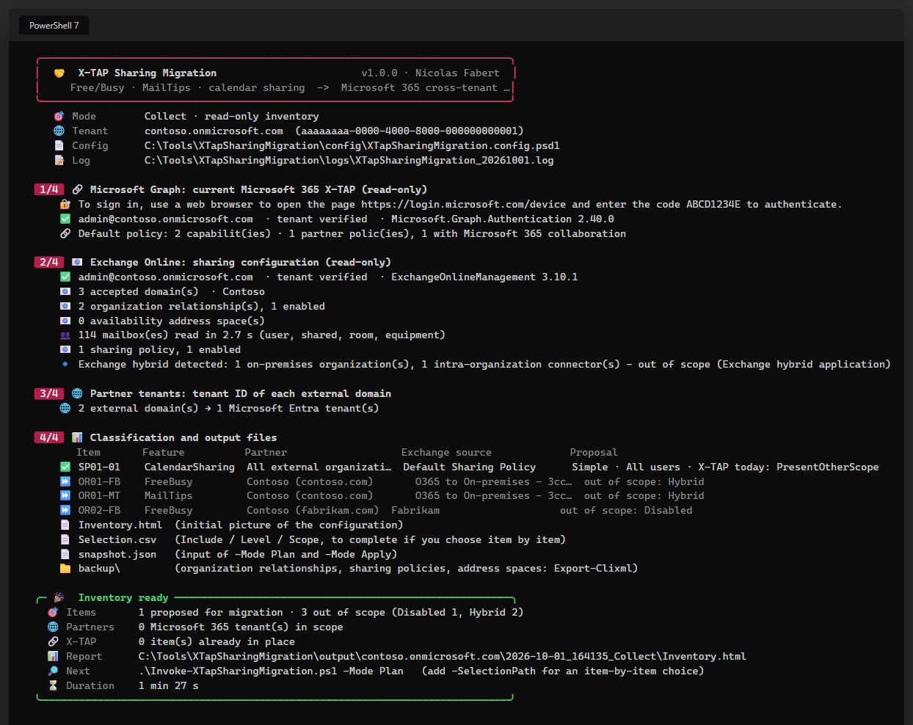

# X-TAP Sharing Migration — User guide

> You do not need to know Graph commands. Follow one step at a time: **where to work, which account to use, what to do, what you should see, and when to stop**. Your first goal is a read-only inventory. Changing the tenant comes later, only after reviewing the plan.

[Download the latest release](https://github.com/Nico77600/XTapSharingMigration/releases/latest) · [What's new](https://github.com/Nico77600/XTapSharingMigration/blob/main/CHANGELOG.md) · [Technical guide](XTapSharingMigration-Guide.md)

This guide describes version 1.0.4. Use the HTML guide included with the ZIP you downloaded when running another version.

| Your path | What happens |
|---|---|
| **Start safely** | Collect and Plan read tenant settings. They do not change sharing. |
| **Review, then change** | Apply Entra creates groups/trusts. Apply Exchange writes sharing settings. |
| **Test with the partner** | Stored settings are not proof that a real calendar share works. |

<!-- icon: checklist -->
## 1. Before you start

### A few words in plain English

| Word in the tool | What it means |
|---|---|
| **Tenant** | Your Microsoft 365 organization. The partner has a different tenant. |
| **X-TAP** | Microsoft's new settings for sharing between organizations. |
| **Capability** | One permission setting: what the partner may see, and for which of your users. |
| **Trust** | Permission for collaboration with a partner organization. It is not a calendar invitation. |
| **Scope** | The users covered by a setting. A group limits it; `All` covers your whole tenant. |
| **Sharing Policy** | The existing Exchange policy assigned to mailboxes for calendar sharing/publishing. |
| **Collect / snapshot** | The saved picture of the settings before migration. Plan and Apply read this picture. |
| **Cutover** | A separately reviewed change to legacy Exchange settings. The tool does not run it. |

**Direction matters:** your tenant's settings control what the partner can see of **your** users. For your users to see the partner's users, the partner must configure its own tenant. Run and review this tool separately for each tenant you administer.

### Workstation and accounts

Use **Windows with PowerShell 7.4 or later**. Open **PowerShell 7** from the Start menu; **Windows PowerShell** is the older 5.1 console. Windows Terminal can host either: check the version instead of relying on the window's appearance.

| Step | Account to use |
|---|---|
| Collect | An account that can read Exchange sharing settings and the Graph inventory |
| Plan | An administrator with Graph read access in this tenant; no Exchange connection is needed |
| Apply Entra | Security Administrator plus Groups Administrator for new groups, or Global Administrator |
| Apply Exchange | Exchange Administrator or Global Administrator |

You can use separate administrators for the two Apply phases. Keep the **same configuration and Collect folder**; the [handover instructions](XTapSharingMigration-Guide.md#two-administrators) explain what to copy. You do not need local Windows administrator rights to install modules with `-Scope CurrentUser`.

The tool requests these delegated Graph permissions. An administrator may need to approve them under your organization's policy; **stop if the app, tenant or permissions do not match what you expect**.

| Run | Graph permissions |
|---|---|
| Collect | `Policy.Read.All`, `CrossTenantInformation.ReadBasic.All`, `Group.Read.All` |
| Plan | `Policy.Read.All`, `Group.Read.All` |
| Apply Entra | `Policy.Read.All`, `Policy.ReadWrite.CrossTenantAccess`, plus `Group.ReadWrite.All` for group creation (otherwise `Group.Read.All`) |
| Apply Exchange | `Policy.Read.All`, `Policy.ReadWrite.CrossTenantCapability`, `Group.Read.All` |

Do not grant extra permissions to get past an unexplained error. The default application is **Microsoft Graph Command Line Tools**; your organization can configure its own approved app in the technical guide.

### Agree on a small first test

Pick one partner and a few test mailboxes. Confirm the feature is available in **both tenants** using the current Microsoft guidance and Message Center **MC1446796**. Rollout dates alone do not prove availability or propagation for your pair of tenants.

Record what users can see **before** changing anything: availability, subject/location, full calendar details, and MailTips with automatic replies enabled. Do not use real confidential calendar content for a publishing test. Exchange hybrid and partners hosted on Exchange Server are outside this migration.

<!-- icon: download -->
## 2. Download and prepare the tool

### 2.1 Download the package, not the source

**Where:** your browser, then File Explorer.

1. Open [the latest release](https://github.com/Nico77600/XTapSharingMigration/releases/latest).
2. Expand **Assets** and download `XTapSharingMigration-<version>.zip`.
3. Do **not** choose **Source code (zip)**, **Source code (tar.gz)** or the green **Code** button.
4. Right-click the downloaded ZIP, choose **Extract All**, and choose a working folder.
5. Find the folder that directly contains `Invoke-XTapSharingMigration.ps1`. Keep all the extracted files together.

**Expected:** that folder also contains `config`, `src`, `templates` and `docs`. Double-click `docs\XTapSharingMigration-UserGuide.html` for this guide offline.

This guide uses `C:\Tools\XTapSharingMigration` as an example. **Replace it with your actual extracted folder.** The ZIP might create an extra version-named folder; use the one containing the script. Only developers using the source checkout work inside `package`.

### 2.2 Open PowerShell 7 in that folder

**Where:** PowerShell 7 on your workstation.

```powershell
Set-Location 'C:\Tools\XTapSharingMigration'
$PSVersionTable.PSVersion
Get-Item .\Invoke-XTapSharingMigration.ps1
Get-ChildItem . -Recurse -File -Force | Unblock-File
```

**Expected:** version **7.4 or later**, then the script's filename. `Unblock-File` normally prints nothing; it removes Windows' downloaded-file marker from these files.

**If not:** a missing script means the wrong directory, not a missing module. Correct the path first. If your organization blocks script execution by policy, ask the administrator; do not disable its policy or use an execution-policy bypass.

### 2.3 Install the modules once

**Where:** the same PowerShell 7 window.

```powershell
Install-Module Microsoft.Graph.Authentication -MinimumVersion 2.25.0 -Scope CurrentUser -Force
Install-Module ExchangeOnlineManagement -MinimumVersion 3.10.1 -Scope CurrentUser -Force
```

If PowerShell asks to install the NuGet provider or trust PSGallery, confirm only if this is your approved installation source. These commands install or update modules for your Windows account. They do not change tenant sharing.

**Expected:** both commands finish without a red error. The Entra-only administrator needs `Microsoft.Graph.Authentication`, not the Exchange module.

**If not:** close PowerShell after updating a module, reopen **PowerShell 7**, return to the same folder and try again. A proxy or installation restriction needs your administrator; do not uninstall all module versions as a first step.

### 2.4 Tell the tool which tenant to use

**Where:** open the existing configuration in Notepad:

```powershell
notepad .\config\XTapSharingMigration.config.psd1
```

In the **Microsoft Entra admin center**, select your intended tenant and open **Entra ID → Overview**. Copy its **Tenant ID**. Find your organization's initial **`xxx.onmicrosoft.com` domain** under its domain names; this is not your administrator's email address.

Find the existing `Tenant` section in Notepad and fill in the two quoted values. **Example of file content — do not run this in the console, and do not replace the entire file:**

```psd1
Tenant = @{
    TenantId     = 'aaaaaaaa-0000-4000-8000-000000000001'
    Organization = 'contoso.onmicrosoft.com'
}
```

Replace **both** example values with yours. Save the file. Keep the other sections and leave the default **Keep** protection unchanged. Never put a password or access token in this file.

**Expected:** your own tenant ID and domain, with quotes and braces intact. At sign-in, the tool checks the connected tenant and stops on a mismatch.

<!-- icon: search -->
## 3. Run the inventory — no changes

**Where:** PowerShell 7, in the tool folder.

**Who:** the account with Exchange and Graph read access.

**Effect:** reads tenant settings and writes local reports; it does not change tenant sharing.

```powershell
.\Invoke-XTapSharingMigration.ps1
```

Sign in to **Microsoft Graph first**, then **Exchange Online**, as prompted. Check the tenant/account in each prompt and complete MFA. Do not manually connect in a different order before the run.

**Expected:** console steps, then a new folder under `output\<your-tenant>\<date>_Collect`. The console gives its exact path. Collection of large mailbox populations can take time; no fixed completion time is guaranteed. Wait for the final summary instead of starting duplicate runs.

Open **`Inventory.html`** in that folder. Review the partner list, items in/out of scope and warnings. An item means one feature of an Exchange sharing object, not necessarily one mailbox.



**Keep this Collect folder intact.** It contains the snapshot, mailbox assignments and Exchange backups used by later steps. Reports contain tenant data; do not upload the folder to a public issue.

For the remaining commands, save the **actual path printed by your run** in `$run`:

```powershell
$run = Read-Host 'Paste the full Collect folder path printed by the tool, without surrounding quotes'
Get-Item (Join-Path $run 'snapshot.json')
```

**Expected:** `snapshot.json` is found. If not, stop and correct the path. `$run` is a variable in this window only; repeat these two commands after opening a new PowerShell window.

**You can stop here** if you only wanted an assessment. No Apply is needed to read the report.

<!-- icon: target -->
## 4. Confirm the partner and review the plan

### 4.1 Confirm who the partner is

Open **`PartnersToConfirm.txt`** inside your Collect folder. It lists partner tenant IDs found from their domains. Have the partner's administrator confirm the relevant ID through an agreed channel. A matching email domain alone is not confirmation from the owner.

Reopen your configuration:

```powershell
notepad .\config\XTapSharingMigration.config.psd1
```

In the existing `Partners = @( ... )` section, add the confirmed partner entry. Replace the sample name, domain and ID. **File content, not a command:**

```psd1
Partners = @(
    @{
        Name     = 'Fabrikam'
        Match    = 'fabrikam.com'
        TenantId = 'bbbbbbbb-0000-4000-8000-000000000002'
    }
)
```

Keep any other partner entries you already have; do not create a second `Partners` section. Save. An existing partner policy or a collected address space can also confirm an ID; the report explains the source.

**Expected:** the partner is confirmed in Plan. **Stop** on **Mismatch** or an unconfirmed partner. Do not turn off `RequireConfirmedPartners` to hide the problem.

### 4.2 Run Plan using the saved Collect

**Where:** PowerShell 7 in the tool folder, with `$run` set as above.

**Effect:** reads Graph, compares settings and writes local reports. No tenant changes.

```powershell
.\Invoke-XTapSharingMigration.ps1 -Mode Plan -SnapshotPath $run
```

Open **`Plan.html`** in the **new Plan folder** printed by this command, not the earlier inventory report. Review the proposed actions, partner, mailbox groups, detail levels and warnings.

| Result | What to do |
|---|---|
| **Create / Update / AddMembers** | A proposed change. Check exactly who receives what access. |
| **NoChange** | The stored setting already matches the plan. This is not a real sharing test. |
| **Conflict** | An existing setting differs and is kept. Review it; do not immediately select Replace. |
| **Blocked** | Read the Detail column and resolve the stated dependency or choice. |

Before Entra has run, Exchange actions that say **run -Phase Entra first** may be expected. Other unknown blockers or conflicts must be understood before continuing. If several detail levels are found, the tool asks which one to keep; do not guess the most detailed level.

### 4.3 Check the users and details

By default, **each Sharing Policy uses a security group of its collected mailboxes**, including inherited default-policy assignments. Missing assignment data or group members outside that policy block automatic use pending review. The tool never removes group members automatically.

If you deliberately want **every local user**, including future mailboxes and users of other Sharing Policies, edit the existing `CalendarSharing` or `AnonymousCalendarSharing` feature entry and change only its `Scope` to `'All'`. Review that exposure with the owner. This is optional, **not** a workaround for missing mailbox data. The [technical scope reference](XTapSharingMigration-Guide.md#3-what-is-migrated--and-what-is-not) explains `All/group`, managed groups and `Keep/Merge/Replace`.

To exclude features or select individual items, follow the [selection instructions](XTapSharingMigration-Guide.md#9-choosing-item-by-item--selectioncsv). **Editing `Selection.csv` alone does nothing:** the same `-SelectionPath` must be passed to Plan and both Apply phases. Likewise, keep any `-Feature` restriction identical in all three commands.

Run Plan again after changing the configuration or selection. **The following Apply examples assume no custom `-SelectionPath` or `-Feature`.** If you used either, carry it forward exactly.

<!-- icon: key -->
## 5. Apply the reviewed settings

> [!WARNING]
> The next commands **change the tenant**. Use only the plan, users and features you have reviewed. Keep the original Collect folder and agree on a rollback plan. Do not run `ManualCutover.txt` at this stage.

### 5.1 Apply Entra — groups and trusts

**Who:** Security Administrator plus Groups Administrator for new groups, or Global Administrator.

**Where:** PowerShell 7 in the same tool folder, using the same Collect.

```powershell
.\Invoke-XTapSharingMigration.ps1 -Mode Apply -Phase Entra -SnapshotPath $run
```

Check the proposed actions and tenant. Type **`YES` only if you intend to make them**. Any other answer cancels before execution.

**Expected:** required groups/trusts are created or reported already in place. Open `Result.html` in this run's new folder. Read **Failed**, **Skipped** and **Not verified** before continuing.

**Nothing to change** can be normal: groups/trusts already exist, or you explicitly selected only tenant-wide default-policy entries. Wildcard sharing still needs effective collaboration trust with each intended partner; the tool never broadly enables default trust.

### 5.2 Apply Exchange — sharing capabilities

**Who:** Exchange Administrator or Global Administrator.

**Where:** the same folder and Collect. A second administrator must receive the full handover, not just `snapshot.json`.

```powershell
.\Invoke-XTapSharingMigration.ps1 -Mode Apply -Phase Exchange -SnapshotPath $run
```

Review again, then type **`YES` only for the approved changes**.

**Expected:** capabilities are configured or already in place. Open this run's `Result.html`. **Verified** means the stored setting was read back successfully; it does **not** mean propagation is complete or that a user has shared a calendar successfully.

If it says **run -Phase Entra first**, complete that phase and review Plan again. A partially failed Apply is not an automatic rollback: inspect what succeeded before rerunning anything.

The normal path uses two phases so each administrator sees their own changes. `-Phase All`, certificate authentication and unattended runs are advanced options in the technical guide, not prerequisites for a first run.

<!-- icon: check -->
## 6. Test with the partner before retiring anything

**First run Plan again** with the same Collect, configuration, selection and feature choices. Investigate remaining conflicts or mismatches. Then test real behavior in **both directions** that your migration is intended to support.

| Test | What success looks like |
|---|---|
| Availability | A partner sees the agreed availability/details for an in-scope test mailbox. An out-of-scope mailbox does not expose them. |
| MailTips | The partner sees the expected automatic reply for a test user whose reply is **on**. Silence alone proves nothing. |
| Calendar sharing | The agreed detail level is offered, the approved invitation succeeds, the recipient accepts and can open the calendar with the expected details. |
| Anonymous publishing, if in scope | An approved synthetic calendar is published at the intended level and checked without sign-in. Do not expose a real private calendar for a test. |
| Unchanged scenarios | Existing sharing, a non-migrated partner and any on-premises/hybrid dependencies still work as intended. |

**An invitation or publication exposes content to others.** Obtain the appropriate approval before that step. Merely opening a dialog is not the whole test.

### Calendar Sharing is not the same as Free/Busy cutover

**Calendar Sharing:** applicable X-TAP takes precedence over Sharing Policies. Leave those policies **enabled during the first tests**. You do not need to disable one to “activate” X-TAP. If X-TAP offers a higher level than the legacy policy, record the observation, but still test the approved full workflow.

**Free/Busy and MailTips:** legacy relationships/address spaces have precedence. Any switch away from them is a separate manual, coordinated change with the partner, using the detailed [cutover and test procedure](XTapSharingMigration-Guide.md#11-after-the-script--partner-window-cutover-tests).

**Wildcard Sharing Policies:** the `*` rule may serve on-premises/hybrid recipients that X-TAP cannot replace. Retirement and cleanup commands are commented out for review; do not uncomment them without checking those dependencies.

### When to stop or roll back

Stop if a user outside the scope becomes visible, more detail than approved is exposed, an expected test fails, or a published calendar is lost. Preserve the observations and return to the agreed baseline.

`ManualCutover.txt` contains **legacy Exchange** restore proposals, not a complete undo of groups, trusts or X-TAP capabilities. Re-enabling a Sharing Policy does **not** override applicable X-TAP Calendar Sharing. Review the saved capability baseline separately; never reset the entire default policy to try to recover.

Only retire legacy rules after actual replacement functionality and dependencies have been verified and a stable observation period has been agreed. Keep backups. A new Collect after stabilization gives you the closing inventory.

<!-- icon: lifebuoy -->
## 7. Understand the result and fix common problems

### Find the right files

Every command prints its own output folder. Do not look only in the first Collect folder for later reports.

| File | Use |
|---|---|
| `Inventory.html` | What Collect found |
| `Plan.html` | What the next Apply would change |
| `Result.html` | What this Apply changed, skipped or failed to verify |
| `snapshot.json` and `SharingPolicyMailboxes.csv` | Inputs from the original Collect; keep together |
| `PartnersToConfirm.txt` | Partner identity coordination |
| `ManualCutover.txt` and `backup\` | Manual legacy-change proposals and original Exchange exports |
| `logs\` in the tool folder | Console/diagnostic history; treat as private tenant data |

Screenshots in the guides are examples, not evidence that your own run succeeded. A phase with **nothing to change** may be correct; read the **Why** and **Next** lines.

### Stop and read the last error

| What you see | First safe action |
|---|---|
| Script not found / “not recognized” | Return to the folder containing `Invoke-XTapSharingMigration.ps1`. Check with `Get-Item`. |
| Module not found or version conflict | Finish module installation, close PowerShell, reopen 7 and return to the tool folder. |
| Wrong tenant/account | Cancel. Check your configuration and the selected account. Do not change the safety check to match a wrong session. |
| No Collect found / wrong snapshot | Use the actual Collect folder from your tenant. Set `$run` again in this window. |
| Partner unconfirmed / Mismatch | Confirm the tenant ID with the partner; correct the existing `Partners` entry. |
| Missing/incomplete mailbox assignments | Keep the default collection of mailbox assignments enabled, run a fresh Collect, and review the new Plan. Do not choose All just to pass the check. |
| Extra members in a policy group | Compare membership with a fresh Collect. Have the owner review the extra users; the tool will not remove them automatically. |
| `All/user` versus `All/group` conflict | The types are different. Review scope and exposure before choosing Replace; Keep deliberately preserves the existing setting. |
| Several detail levels / Conflict | Review intended access with the owner. Do not automatically choose the highest level or replace all existing settings. |
| “YES expected” | Apply was cancelled before execution. Rerun only if you now intend the reviewed changes; do not add `-Force` just to hide the prompt. |
| Calendar share refused / only availability offered | Review the capability, scope, effective trust and current service behavior. A policy error does not identify a single cause or a fixed waiting time. Keep fallback policies intact while investigating. |
| Green Result, but sharing still fails | Configuration readback is not a runtime test. Record exact response/time and check with the partner; do not repeatedly reapply unchanged policies. |

Exit code **0** means the command succeeded; **1** means an error/action failed; **2** means review is needed (blocked, cancelled, skipped or unverified work, or an incomplete collection). These codes are not a certification of working external sharing.

For certificate mode, every configuration option, browser traces and advanced recovery, use the [technical guide](XTapSharingMigration-Guide.md). Before requesting help, remove addresses and configuration details as appropriate; never share passwords, tokens, cookies or raw browser HAR files.
